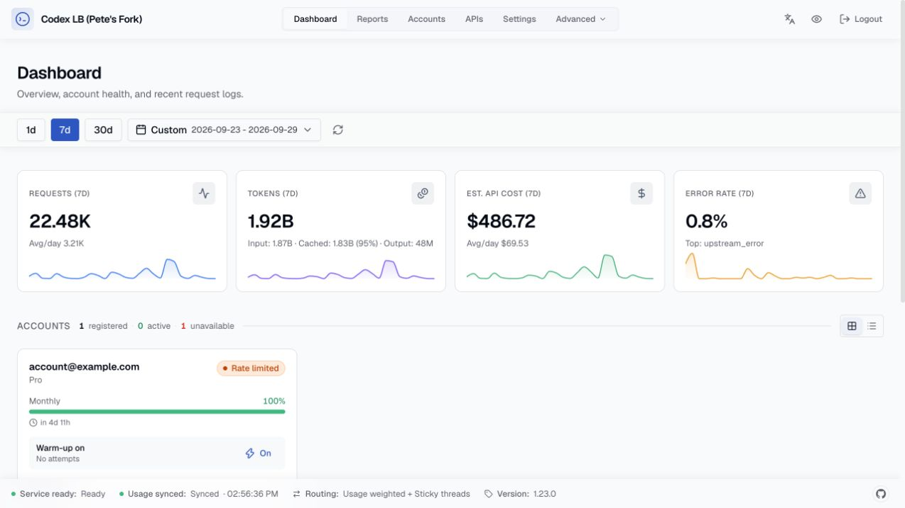
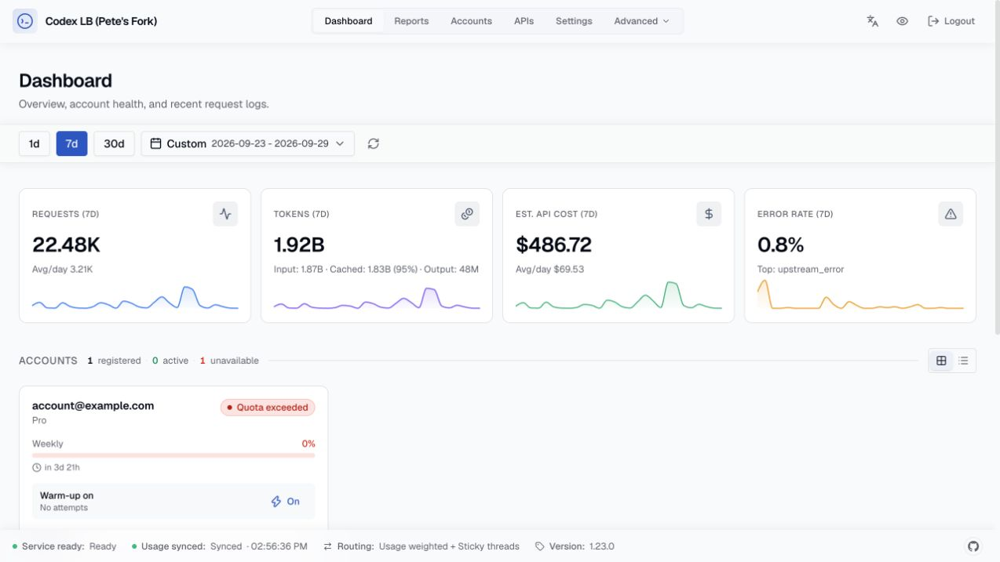
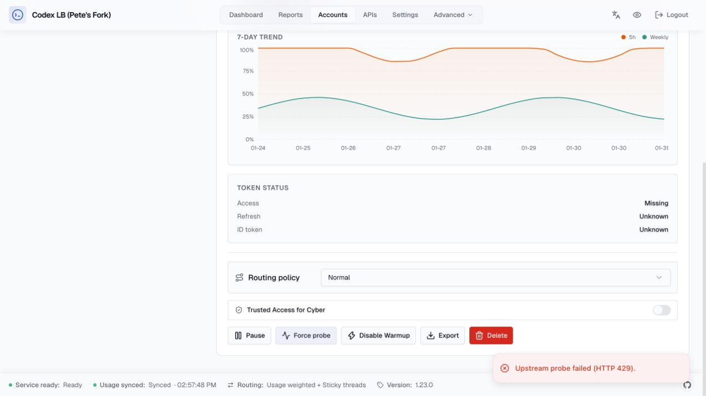

# Current quota and probe outcomes

A September 29 incident showed a Pro account with a green Monthly 100% balance
and a rate-limited badge. The latest upstream usage was weekly and exhausted;
the monthly row was from September 4. Force Probe returned 400 because its request
included unsupported max_output_tokens. Removing that field produced an upstream
429 with the same weekly reset, confirming actual exhaustion.

The fix selects current quota evidence without deleting history or forcing an
account healthy. For example, a new weekly 100%-used sample now renders Weekly
0% remaining even if an old monthly sample reported 0% used. A rejected probe
shows an error notification and still refreshes quota data.

## Browser evidence

Before and after payloads were generated from the same synthetic history by the
actual account mapper in the prior and corrected source trees. The built UI now
shows Weekly 0% with Quota exceeded. A synthetic HTTP 429 probe produces an error
notification. No real account identifiers or credentials are in these fixtures.

