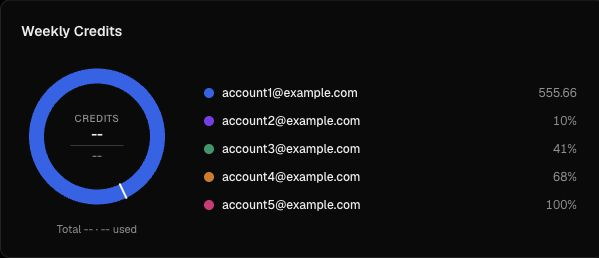
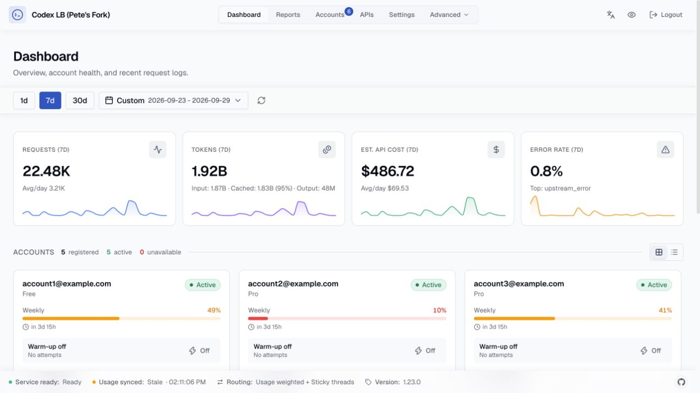

# Dashboard quota-chart removal

The operator requested removal of the weekly and 5-hour pooled quota charts.
The weekly chart mixed numeric credits and percentages and drew a ring from
only the known subset. The 5-hour panel no longer provided useful information
for the current pool.

These two panels are removed, with no replacement percentage graph. Quotas
remain available in existing account cards, list rows and account details.
The weekly pace card retains its existing eligibility rules; reports charts
and API-key cost charts are unaffected. This is a frontend-only change and
requires no database rewrite or service restart.

For example, a dashboard pool with one numeric credit balance and four unknown
Pro credit amounts proceeds from summary cards to the accounts section instead
of displaying a misleading pooled ring.

## Browser evidence

The same synthetic mixed-capacity fixture was served with the prior and corrected
production builds. Both pooled chart headings are absent from the corrected
dashboard; summaries and account-level quota bars remain visible. These screenshots
use synthetic accounts, not live account data.

