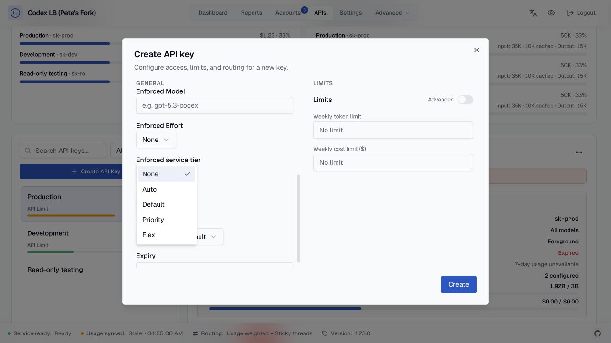
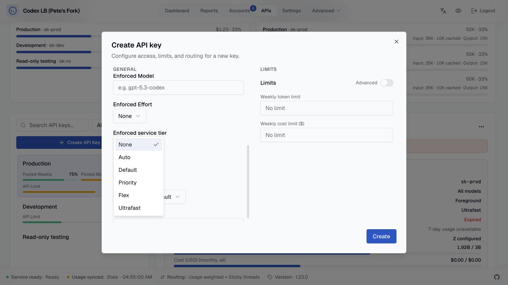

# September 2026 launch compatibility

## Purpose and decisions

GPT-6.1 Sol and Astra Ultrafast already appear in the per-account upstream
catalog. This change preserves that discovery path and its model metadata,
while adding the missing local prices and dashboard tier control.

Current and grandfathered Pro subscriptions no longer have a reliable shared
absolute allowance in the data available to this fork. Plan labels and monthly
subscription prices cannot establish that allowance. Pro-family credit amounts
therefore remain unknown; reported percentages and reset times remain useful.
Mixed routing pools compare remaining percentages on a common basis. Fully
known pools retain their absolute-capacity behavior.

Ultrafast is eligible only with an authoritative per-account catalog entry.
General Pro model eligibility does not grant Ultrafast access. An enforced
Ultrafast request cannot silently become a Standard request.

For example, a Pro Max account reporting 25% monthly usage contributes 75%
monthly availability without claiming a numeric included credit balance. An
API key can display that monthly percentage separately from its weekly pool.
Credit forecasts are withheld when an eligible account's allowance is unknown;
the legacy estimate of how many Pro subscriptions would cover a shortfall is
also withheld.

## Operational boundaries

No migration, model-default change, production restart, subscription change,
or historical data rewrite is part of this implementation. Historical prices
are API-equivalent estimates, separate from subscription consumption and quota
counters. Pricing is shared by admission reservations, settlement and logs.
Actual upstream service tier takes precedence over the requested tier.

A complete successful usage refresh can record that a short window is absent.
Missing rate-limit objects, incomplete windows and errors cannot clear prior
quota evidence. Persisted health and cooldown constraints remain independent.

## Read-only historical preview

On September 29, 2026 the existing usage database was opened with SQLite
`mode=ro` and `PRAGMA query_only=ON`. The existing repair function ran with
`apply=False` for exact stored model IDs `gpt-6.1-sol`, `gpt-6-sol`, `gpt-6-luna`
and `gpt-6-astra` across retained history:

- 142,122 rows scanned; 6,708 estimates would change.
- Estimated total correction: +207.2061883 USD.
- 12,536 scanned rows lacked retained cache-write counts. Those estimates cannot
  recover unreported cache-write premiums.

This is a preview of that snapshot, not an applied repair or a bill. Future
preview counts will differ as traffic arrives. A separately requested apply
requires a backup and another preview; the repair does not rewrite quota
enforcement counters.

## UI evidence

The baseline and implementation dashboards were served from separate checkouts
against synthetic fixture APIs. No live dashboard credentials or accounts were
used. The implementation displayed the Ultrafast selector and separate weekly
and monthly pool percentages with nullable capacity.

## Sources

Official pages inspected September 29, 2026:

- [GPT-6.1 Sol model](https://developers.openai.com/api/docs/models/gpt-6.1-sol)
- [API pricing](https://developers.openai.com/api/docs/pricing)
- [Ultrafast API mode](https://developers.openai.com/api/docs/guides/ultrafast-mode)
- [Codex pricing](https://learn.chatgpt.com/docs/pricing)
- [Codex Ultrafast access](https://learn.chatgpt.com/docs/agent-configuration/speed#ultrafast-mode)
- [ChatGPT Pro tiers](https://help.openai.com/en/articles/9793128-about-chatgpt-pro-tiers)

The allowance uncertainty is deliberate: these pages and the observed usage
schema did not establish absolute Pro capacities. Published Sol pricing is
promotional through at least November 21, 2026, so the normal pricing-snapshot
maintenance process still applies.
